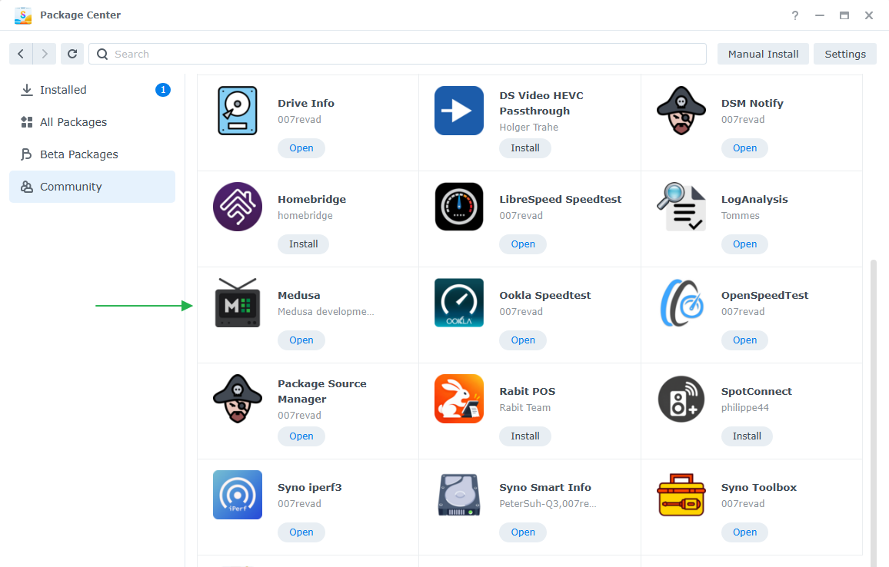
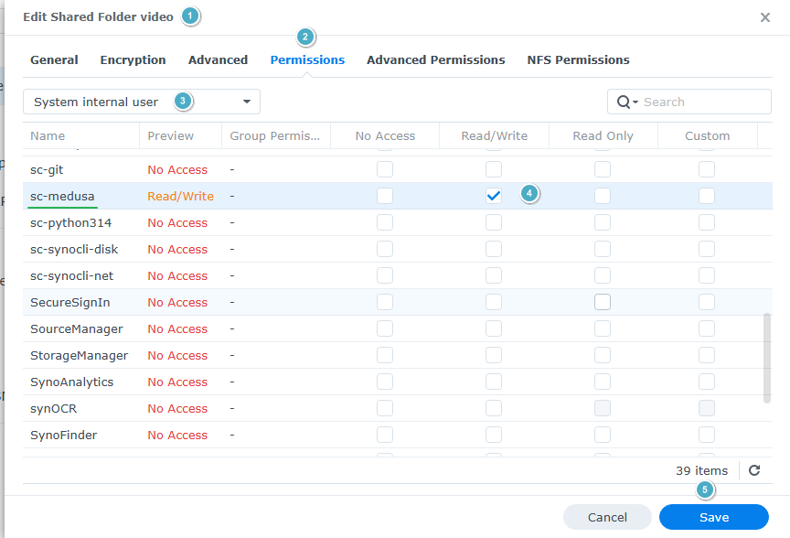
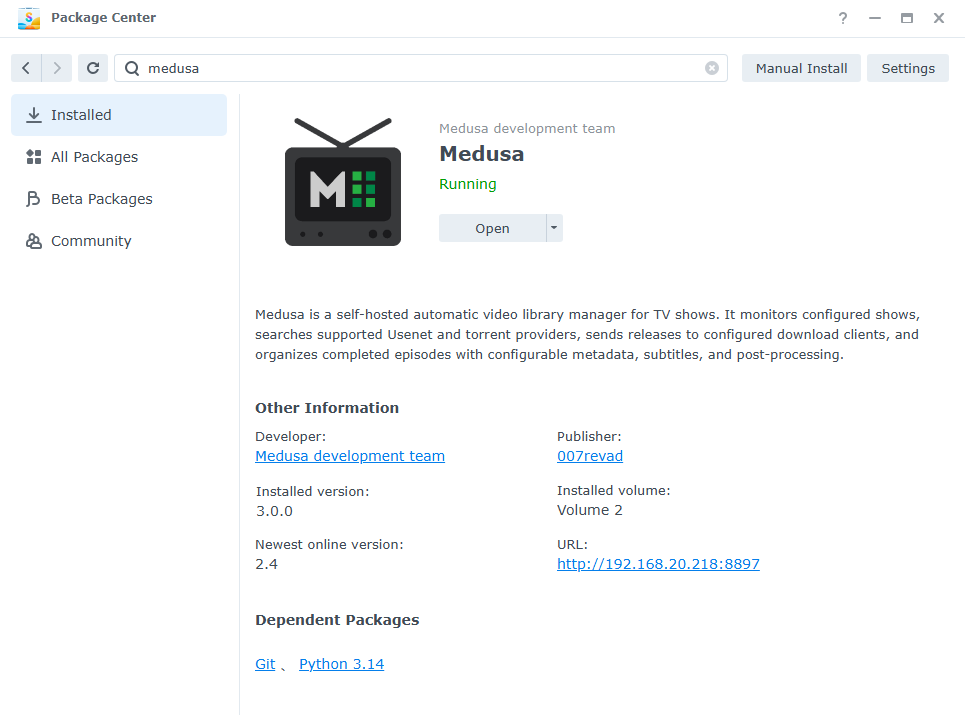
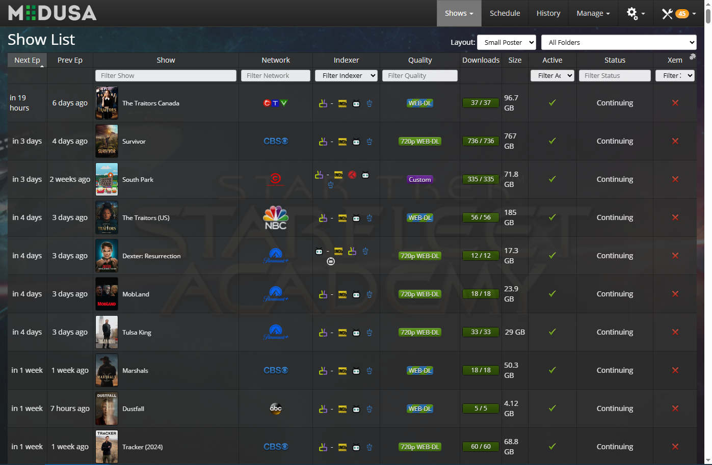

#  Synology Medusa

<!---  --->

### Description

Medusa is a self-hosted automatic video library manager for TV shows. It monitors configured shows, searches supported Usenet and torrent providers, sends releases to configured download clients, and organizes completed episodes with configurable metadata, subtitles, and post-processing.

[Medusa](https://github.com/pymedusa/Medusa) package for Synology DSM 7 and 6, which upgrades BenjV's Medusa package.

- Medusa is cloned from GitHub, so Medusa's own **Update Now** works.
- Uses the newest installed Python that meets Medusa's minimum version (`requires-python`). The package depends on the SynoCommunity `python314` package, which leaves room for Medusa's minimum to rise.
- Medusa runs under a small supervisor, so **Restart** and **Update Now** in the web UI relaunch Medusa (re-picking the Python) instead of hanging. Medusa's **Shutdown** button also restarts Medusa; stop it from Package Center.
- Requires the SynoCommunity Git and Python 3.14 packages.
- Log of the supervisor: `/var/packages/medusa/var/supervisor.log`

Medusa is on port 8897. Runs as `sc-medusa:synocommunity`, same as BenjV's package, so your existing config and database are kept when upgrading.

### How to install the package

There are 2 ways to install the package:

**Directly from Package Center (recommended)**

Installing from a package source means Package Center will notify you when there is a Medusa package update.

1. Add [007revad Synology Package Source](https://github.com/007revad/Synology_package_source) to Package Center.
2. Add the SynoCommunity package source too, as Medusa needs its 'Git' and 'Python 3.14' packages. The easy way is to install Package Source Manager, which can add SynoCommunity (and other sources) to Package Center for you.
3. Click on the Community section in Package Center and install Medusa.

<kbd></kbd>

**Or download the package and install it manually**
1. Install the 'Git' and 'Python 3.14' packages from [SynoCommunity](https://synocommunity.com).
2. Download the latest version .spk file from https://github.com/007revad/Synology_Medusa/releases and save it to your Synology.
3. In Package Center click on Manual Install.
4. Browse to where you downloaded the .spk file.
5. Select the .spk file and click Next.

## Permissions

Medusa runs as the hidden system user `sc-medusa`, and can only see the shared folders that user has been given access to.

1. In DSM go to Control Panel > Shared Folder.
2. Select a folder that holds your TV shows or downloads and click Edit > Permissions.
3. Change the drop-down to **System internal user** and give `sc-medusa` **Read/Write**.
4. Repeat for each shared folder Medusa needs, then browse to it in Medusa.

<kbd></kbd>

### Screenshots

<!--- 
Description of image 2 goes here
 --->

<kbd></kbd>

 

<!--- 
Description of image 2 goes here
 --->

<kbd></kbd>

